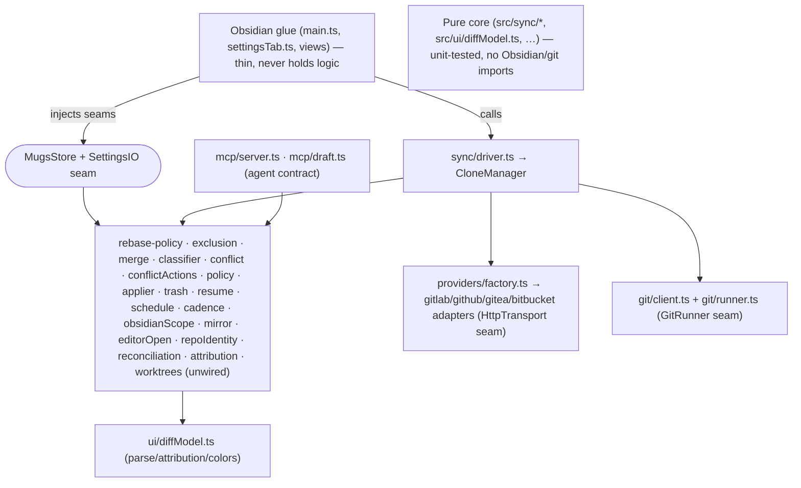

# MUGS — Multi-User Git Sync: Architecture & Decisions

This document is the single source of truth for how MUGS works, why it is built the way it is, where its design was inspired from, and how each hard problem was solved. It is written against the shipped code in `src/` and is meant to let a reader understand, review, and maintain the system independently of any one author.

> **Read guidance.** Start with §1 (the pipeline), skim §2 for the module map, then read §3 area-by-area in the order the areas were built (A→K). §4 maps each inspiration to where it lives. §5 is focused problem→solution writeups. §6 maps tests to behavior.

---

## 1. What MUGS is and how it works end-to-end

MUGS is an Obsidian plugin that syncs **selected folders of a vault** against **folders/subtrees of one or more remote git repositories**, for a team where different users may point the same mapping at different local folders. It is *multi-user* because (a) many people can share one repo while syncing only their own subtree, and (b) AI agents can be registered as attributed sub-users: a mapping pinned to an agent attributes its pushes to that agent (own committer identity + an `On-behalf-of` owner trailer). Isolated agent branches/worktrees are designed (`src/sync/worktrees.ts`, pure and tested) but not yet wired into the sync path.

The guiding architectural invariant, repeated throughout, is:

> **All correctness-sensitive logic lives in pure, dependency-free, unit-tested modules under `src/sync/` (and a few under `src/ui/`, `src/providers/`, `src/membership/`). The Obsidian/glue layer (`main.ts`, `settingsTab.ts`, the views) is thin: it wires injected seams and renders data — it never contains merge, scope, or policy logic.**

This invariant is what makes the vitest suite (825 tests across 68 files when last verified against the 0.3.28 tree; the count drifts as tests land) possible without a real git binary, network, or Obsidian runtime (plus real-git end-to-end suites that do use the binary).

### 1.1 The sync pipeline

One **sync pass** (`syncAllMappings` in `src/sync/driver.ts`) runs over every folder mapping and, per mapping, delegates to one `CloneManager.syncMapping` pass against that mapping's clone. Clones are keyed by the resolved `RepoIdentity` (provider + repo + branch + canonical remote): every mapping pointing at the same identity shares one clone (`repoIdentity.ts`), serialized by an in-process keyed mutex plus an advisory lock file that *blocks* (never steals) a competing process. A pre-identity legacy clone holding uncommitted or unpushed work blocks the mapping for review and is never reset; a clean one migrates. Per mapping the flow is:

```
credential → provider (REST adapter) → find repo → ensureClone (identity-keyed)
   → fetch (--prune)
   → read topology: baseSha (last synced), localSha (HEAD), remoteSha (origin/branch)
   → decideSyncAction(topology)        [pure: rebase-policy.ts]  none | fast-forward | rebase
   → mergeSides: file-level 3-way merge of diverged paths into the clone working tree
        (genuine conflicts are recorded + surfaced — never auto-resolved)
   → mixed reset onto the remote tip (keeps the merged working tree; no git pull/rebase runs)
   → mirrorPull: land in-scope clone content into the vault (editor-deferred ops → durable pendingOps)
   → if push permitted: stage in-scope paths (held paths excluded) → scoped commit (temp index) → push
   → verifyReconciliation: vault bytes vs published blob IDs (ls-tree); unknown remote-only paths → review
   → record last-sync state (base SHA + op id); correspondence advances only with zero pendingOps
     and every path verified (reconciliation fingerprint mismatch clears all proven ownership)
```

**Pull-time content merge.** When histories diverge, `CloneManager.mergeSides` gathers every in-scope path (clone index ∪ vault-only names), reads base/ours/theirs per bounded batch — ours from the vault mirror, theirs from the fetched tip — and runs them through the pure merge pipeline (§1.2). Clean changes land in the clone's working tree; genuine overlaps are persisted per mapping (replace-by-path, so a fresh divergence supersedes the stale record) and surfaced in the Conflicts panel.

**Push-time scoping + attribution.** The pass stages exactly the merge's applied paths — plus clone working-tree changes only in the legacy no-mirror mode — filtered to **in scope** (`isInScope`, §4) and not held. The commit is built from a temporary index seeded with only this mapping's staged entries, so unrelated index state in a shared clone can never leak into it. It is attributed normally — or, when the mapping pins an agent (§10), to that agent with an `On-behalf-of` owner trailer.

**Reconciliation (path-level ownership).** Neither a filename nor an mtime proves a vault received a remote file — a matching Git blob does. Every pass computes a fingerprint over the repo identity and the mapping's shape (local folder, remote path, direction, filters); any change to that shape invalidates all proven ownership and correspondence — proof is never carried across re-scoped links. After first-push and after normal passes, `verifyReconciliation` checks vault bytes against the published blob IDs from the remote tree (`git ls-tree -r -z --full-tree`; symlinks/submodules and unsafe paths skipped; no lazy blob downloads). Unknown remote-only paths (legacy files this vault never received) land in a per-mapping `review` set — never auto-deleted, never blocking the pass from completing. Held (editor-staged), pending, unreadable, or content-mismatch paths are withheld from proof (advisory). The `correspondenceSha` anchor ("last completed sync", used by since-sync Diff) only advances when every path is verified. Deletion propagation is per-path: a remote file may be deleted only if its path is blob-proven; unproven paths are retained on the remote. A proven local deletion that races a remote edit (the remote blob changed after the local delete's base) is not pushed — it becomes a review entry and the remote content is preserved. Explicit user decisions (delete remote / recover into vault) execute with revision-bound preconditions (safe-path, scope, ref match, blob match, editor-open guard, versioned trash record); a changed remote blob re-queues the path for review instead of executing a stale decision. Review items do not change the outcome status: a pass that completes with items awaiting review reports `status: "ok"` and carries the review list as advisory data on the outcome; the Reconciliation review modal (`ui/reconciliationModal.ts`) is the user surface listing review rows (path, reason, remote ref) with explicit per-file decisions. (`reconciliation.ts`, `cloneManager.ts`, `driver.ts`)

### 1.2 The pure merge pipeline (one file)

Every diverged file flows through this deterministic sequence:

```
FileVersions { path, base?, ours?, theirs? }  (undefined = deletion, jj None)
   → threeWayMerge(base, ours, theirs)       [merge.ts]       MergeResult { content, conflict, ...Absent flags }
        │ delete cases resolved here (see §3.1)
        │ present-only → diff3 walk (LCS anchors + region classify)
        ↓
   applyMerge(entries)                        [conflict.ts]    → AppliedChange[] (writes/deletes) | FileConflict[] to surface
   orderApplyOps(applied)                     [applier.ts]     safe ordering (parents-first, deletes-last)
   applyOrdered(...)                          [cloneManager.ts] clone working-tree writes (no editor guard here —
                                               the vault-side guards live in mirrorPull, where paths are vault space)
```

Genuine conflicts stop here: they are persisted (replace-by-path) and surfaced in the Conflicts panel for an explicit ours/theirs/both choice. `policy.ts` (`resolveConflictAuto`, recency-wins) remains a pure, tested decision helper, but no production path calls it — when `recencyWins` is on, the engine only *attaches* each side's timestamps (vault mtime; last commit touching the path) to the conflict record so the panel can offer a suggested winner (Area 2). The pure `ApplyGuard` per-path re-entrancy serializer is unit-tested but unwired; production prevents stacking via the single in-flight pass guard and suppression of vault events the plugin itself caused (`internalWritePaths`, main.ts).

### 1.3 Component diagram (pure core vs Obsidian glue via DI)



The seams that make this testable: `SettingsIO` (store), `GitRunner` (git client), `HttpTransport` (providers), `WorkingTreeWriter` / `ConflictStore` / `EditorOpenGuard` / `LastSyncAccessor` (clone manager). `main.ts` supplies the concrete implementations; tests supply fakes.

### 1.4 Module map

| Area | Path(s) | Role |
|---|---|---|
| Data plane | `src/types.ts`, `src/schema.ts`, `src/store.ts` | Domain types, Zod source-of-truth, persistence + token handling |
| Git client | `src/git/{types,client,runner}.ts` | Thin git wrapper over an injectable runner |
| Providers | `src/providers/{factory,http,types,gitlab,github,gitea,bitbucket,schema}.ts` | REST adapters per backend behind one `Provider` interface |
| Membership | `src/membership/{types,merge}.ts` | Correlate remote roster + local activity into a summary |
| Scope/exclusion | `src/sync/exclusion.ts` | gitignore matcher, scope predicate, rename detection, conflict-path |
| Merge/conflict | `src/sync/{classifier,merge,conflict,conflictActions,policy,trash}.ts` | The 3-way pipeline, conflict records + action labels, suggestion policy, recoverable deletions |
| Pull topology | `src/sync/rebase-policy.ts` | Pure pull-action decision from commit topology |
| Applier | `src/sync/applier.ts` | Safe write ordering + per-path re-entrancy guard |
| Resumable state | `src/sync/resume.ts` | Deterministic base-SHA + op-id resume key |
| Cadence | `src/sync/cadence.ts` | Human preset ↔ concrete interval mapping |
| Scheduling | `src/sync/schedule.ts` | Pause gate, visibility reducer, event debounce |
| Obsidian config | `src/sync/obsidianScope.ts` | Personal vs vault-wide `.obsidian/` classification |
| Commit message | `src/sync/commit-message.ts` | Deterministic greppable sync messages (+ on-behalf-of trailer) |
| Attribution/worktrees (A10) | `src/sync/{attribution,trees}.ts` | Agent attribution + isolated-branch lifecycle |
| MCP (A10) | `src/mcp/{server,draft}.ts` | Agent tool contract + commit-draft composition |
| Clone identity | `src/sync/repoIdentity.ts` | Identity-keyed clone layout, in-process mutex, advisory lock |
| Reconciliation | `src/sync/reconciliation.ts` | Path-level ownership proof: fingerprint, Git blob IDs, ls-tree parse, per-mapping proven/review/decisions state |
| Clone/driver | `src/sync/cloneManager.ts`, `src/sync/driver.ts` | Per-mapping pass + cross-mapping driver over identity-keyed shared clones |
| Vault mirror | `src/sync/mirror.ts` | repo↔vault path mapping + the pure pull planner (`planMirrorPull`) |
| Editor guard | `src/sync/editorOpen.ts` | Open-editor write/delete deferral (any open file = unsafe) |
| Runtime | `src/runtime/{conflictResolver,statusReport}.ts` | Manual resolution transaction; aggregate status report |
| Diff model (A7) | `src/ui/diffModel.ts` | Unified-diff parse, per-file attribution, author colors |
| Views (glue) | `src/ui/{mapView,diffView,diffPanel,diffRender,mapModel,dataSources,defaultDataSources,reviewQueueView,reconciliationModal}.ts` | Registered Obsidian views + data sources |

---

## 2. Design decisions & rationale (area by area)

### Area 1 — Folder granularity: full-folder vs subtree (+ fine-grained excludes)

**Problem.** A mapping either synced the whole repo (`remotePath = ""`) or a single subtree, with no way to drop individual files inside a scope.

**Options considered.** (a) A new allow/deny model; (b) reuse gitignore semantics already familiar to developers; (c) full path-prefix matching only.

**Chosen.** `includes`/`excludes` as **gitignore-style globs** on each mapping (`GitignoreMatcher` in `exclusion.ts`). `remotePath = ""` + excludes ⇒ *full-folder sync with exclusions*; a set `remotePath` ⇒ *subtree refined by globs*. The single effective predicate is `isInScope(config, path)` (subtree membership **and** include/exclude rules), wired into the driver for both pull (`mergeSides`) and push (scoped staging).

**Tradeoffs.** gitignore semantics are well-understood and expressive (`!` negation, `*`/`**`/`?`, directory trailing slash). The cost is that globs can surprise users; the settings UI documents each field's meaning.

### Area 2 — Conflict resolution: clean auto-merge, human-decided conflicts

**Problem.** Users want sync to feel continuous (like Obsidian Sync / Figma), yet never lose a side of a genuine conflict to a silent winner.

**Options considered.** A manual conflict UI for everything (rejected: clean changes need no human); last-write-wins on genuine conflicts (rejected: loses content); **clean auto-merge + explicit resolution for genuine conflicts, reversible via git history / `.mugs-trash`** (chosen).

**Chosen.** A top-level `sync` policy (`SyncPolicy`) with:
- `autoMerge` (default true): every divergence runs the 3-way merge; clean results apply without prompting.
- `defaultResolution` ("both" | "theirs" | "ours", default "both"): the *suggested* tie-break for overlapping hunks — offered by the panel and settings, never applied by the engine.
- `sameChangeAccept` (default true): jj's same-change rule. The identical-change collapse is inherent to `threeWayMerge`; the toggle is persisted but not consulted by the engine.
- `recencyWins` (default true): when on, the engine attaches each side's timestamps (vault mtime vs the last commit touching the path) to conflict records so the panel can offer a one-click suggested winner; near-equal or missing timestamps leave the suggestion to `defaultResolution` only.

Genuine conflicts (overlapping edits, divergent add/add) are **recorded and surfaced**: the Conflicts panel asks for an explicit ours/theirs/both choice, and the settings UI labels the tie-break/recency options as suggestions that are "never applied silently". The pure decision helper (`policy.resolveConflictAuto`) exists and is pinned by tests, but no production path calls it — a resolution is applied only by a human click (panel or Diff view) through the runtime resolution transaction (`runtime/conflictResolver.ts`: identity check → originals preserved → clone + vault writes → save-acknowledged). Reversibility (git history + trash + `.mugs-origin` sidecars) is what makes explicit resolution safe.

### Area 3 — Deletes as first-class values (.mugs-trash) + real-time automatic merging + safe applier

**Problem.** The original merge treated a deleted file as `""`, so a local delete vs. remote modify showed as a false content conflict; and there was no recovery for deletions.

**Chosen (three coupled pieces):**

1. **Deletes as values (jj model).** Content is `string | undefined`; `undefined` is a deletion, strictly distinct from an empty file (`""`). `threeWayMerge` resolves every delete case deterministically (§3.1) before the line-level diff3 walk ever sees a deletion.
2. **Real-time automatic merging.** Clean divergences are auto-merged into the working tree on pull and pushed through the same pipeline — "real-time" is approximate (git polling), but local edits propagate via event triggers within one ~1.5 s coalesce window (§5).
3. **`.mugs-trash` (`trash.ts`).** Before any file is removed during sync, its content is recorded at the clone root's trash store — `<cloneRoot>/.mugs-trash/<mappingId>/<path>` with a versioned suffix (`.mugs-v<ts>-<hash>`), so repeated deletions never overwrite an earlier recovery copy — making the deletion recoverable and distinguishable from a user delete.

**Safe applier (`applier.ts`).** **Ordering** keeps write-backs from corrupting the tree: writes before deletes; writes parents-before-children, deletes children-before-parents (`orderApplyOps`, used by every production apply). The pure `ApplyGuard` per-path re-entrancy serializer is unit-tested but unwired; in production, stacking is prevented by the single in-flight pass guard and by suppressing vault events the plugin itself caused (`internalWritePaths`, main.ts).

#### 3.1 Delete-case matrix (what `threeWayMerge` + `applyMerge` actually do)

| base | ours (local) | theirs (remote) | Result |
|---|---|---|---|
| absent | absent | absent | file never existed → gone |
| present | deleted | deleted | stays deleted (deletion applied) |
| present | deleted | unchanged (== base) | deletion propagates |
| present | unchanged (== base) | deleted | deletion propagates |
| present | deleted | modified | keep the survivor's changed content — no conflict |
| present | modified | deleted | keep the survivor's changed content — no conflict |
| absent | added | added (identical) | collapse to one copy |
| absent | added | added (different, overlap) | conflict — surfaced for manual resolve |
| absent | deleted | added (or vice versa) | keep the addition |
| present | present | present | normal line-level diff3 merge; overlap → conflict surfaced |

The payoff: **no false content conflict on any delete case**, and an untouched survivor never resurrects a deleted file (`applyMerge`'s unchanged-survivor cases turn those into propagated deletions). Only overlapping add/add or edit/edit conflicts surface.

**Sync-level overlay.** This matrix is the *content-level* verdict. Whether a vault-absent path may act as "ours deleted" at all is gated one level up. For reconciliation-active mappings the gate is **per-path**: a remote file may be deleted only if its path is blob-proven (vault bytes verified against the published Git blob ID); unproven paths are retained on the remote, and an additive first push never grants global deletion permission. A proven local deletion that races a remote edit (the remote blob changed after the local delete's base) is not pushed — it becomes a review entry and the remote content is preserved. The old global `vaultPopulated` delete gate is superseded for reconciliation-active mappings; pull-only mappings still never publish deletions, and a populated mapping whose vault folder goes empty refuses the pass rather than mass-delete the remote subtree.

### Area 4 — Right-sidebar diff panel (pinned)

**Problem.** Users want a live diff open beside their notes, not a full editor tab each time.

**Chosen.** A real registered sidebar view (`MugsConflictsPanel` in `diffPanel.ts`, registered as `mugs-conflicts` via `registerView` and opened into `getRightLeaf`), living alongside Obsidian's built-in Outline/Tags/Backlinks. An earlier revision called `workspace.createPanelTab` — a method that does not exist in Obsidian — so the panel could never open; it is a proper `ItemView` now. The full-tab `DiffView` and the panel share one extracted renderer (`diffRender.ts`) — single source of truth for diff/conflict presentation, folding, and attribution.

### Area 5 — Sync frequency + adaptive cadence + event triggers + editor-open guard + resumable state

**Problem.** Aggressive polling wastes power and spams the backend; too lazy and sync feels broken. Local edits should propagate fast without polling every keystroke.

**Chosen:**
- `sync.intervalSeconds` drives a gated poll (`POLL_TICK_MS = 15s` internal tick; `decideRun` enforces the real interval; one pass runs shortly after plugin load). Presets: efficient (3600s), balanced (300s, default), near-realtime (30s), clamped to [1s, 1 day] — `cadence.ts`.
- **Event triggers:** `vault.on('modify'|'create'|'delete'|'rename')`, scoped to mapped folders. A burst coalesces into one sync within a short window (`EVENT_COALESCE_MS = 1.5s`, fed through `debounceFireTimes`; the older 20s `EVENT_DEBOUNCE_MS` constant is vestigial). Plugin-caused writes are suppressed (`internalWritePaths`). Becoming visible again restores the last terminal status — it does not force an extra pass.
- **Editor-open write-back guard** (`editorOpen.ts`): *any* file open in an editor is treated as write-unsafe (Obsidian exposes no dirtiness API on `TFile`; over-blocking is the safe failure mode). Such writes and deletes defer into durable pending operations rather than clobbering an in-progress edit.
- **Resumable state** (`resume.ts`): last-sync is keyed on git base SHA + monotonic op id, not a timestamp, so an offline session resumes cleanly and reconnect reconciles deterministically.

**Correctness caveat.** True zero-latency is impossible with git polling; MUGS approximates real-time for local edits and pulls remote drift within one interval or on foreground. This caveat is stated honestly in the code and docs.

### Area 6 — Status-bar sync + conflict indicator (vault-global)

**Problem.** Users need at-a-glance sync state and a fast route to whatever needs attention.

**Chosen.** `addStatusBarItem()` renders the vault-global sync state — `⟳` with live phase text while a pass runs, `✓ synced HH:MM`, `⚠ needs merge`, `✗ sync issues`/`✗ failed`, `⏸ paused`, `👁 hidden`, `● idle` — and persists the last terminal state across visibility changes. **Clicking the item routes to the surface that needs attention**: the Conflicts panel (§Area 4) when any mapping has unresolved conflicts, otherwise the Diff view with the last-sync report; a hover tooltip states the click target. A focused-file-aware bar (a per-mapping glyph for the active note) is not implemented — `resolveMappingForPath` is used to scope vault file events to their mappings, not to render the bar; per-mapping status lives in the Map view.

### Area 7 — Diff view: per-change attribution + folding + action-labeled conflicts

**Problem.** "Who changed what" should be obvious without clutter; conflicts should read as *what each side did*, not opaque blobs; and large diffs should collapse.

**Chosen:**
- **Attribution.** `diffModel.ts` parses a unified diff and attributes each hunk to the file's most recent committing author (`attributeHunks`). Each author gets a stable, well-separated accent color (`assignAuthorColors`, golden-angle distribution); changed lines are tinted so "who did what" reads at a glance. (Per-*file* attribution is an intentional, testable approximation of per-hunk blame: `AuthorsByFile` carries each file's committing authors newest-first, and every hunk of a file is attributed to that file's most recent committing author. True per-hunk blame is future work.)
- **Comparison modes.** *Since completed sync* uses the proven `correspondenceSha` (labeled "last completed sync"); without it the view says so rather than pretending a fetched tip is the baseline. *Previous commit* (HEAD~1) and *Custom older ref* validate that the ref exists and is an ancestor of HEAD. All comparisons are two-endpoint (not merge-base) and scoped to the mapping's subtree; the target is always committed HEAD, so unsynced vault edits never appear.
- **Action-labeled conflicts.** Conflict regions render with action labels (`begin deleted left` / `begin added right`, Manyana-style) so a human sees what each side did.
- **Folding.** The shared renderer renders each hunk as a collapsible section and folds unchanged context by default (DOM-only, no git changes).

### Area 8 — Vault cleanup / maintenance mode: pause + human-in-the-loop review

**Problem.** Users need a safe way to make bulk edits without automatic sync interfering, then review everything before it goes out.

**Chosen:**
- **Global pause (`sync.paused`)** holds across reloads (durable) plus an in-memory lock. While paused: the poll is suspended, event triggers are suppressed, and the driver performs no auto-pull/push. Exposed via settings toggle; shown with an explicit "paused" glyph (§6). Unpausing simply re-opens the gate — the next poll tick (≤15 s) catches up on drift made while paused; there is no special one-shot resume pass. The pause gate is the pure `decideRun` (`schedule.ts`), which also vetoes while the window is hidden and enforces the minimum interval.
- **Review queue** (`ReviewQueueView`, `mugs-review`) models GitButler's staged-changes/draft-PR review: changes are curated into states *unstaged* (pending) / *staged* (selected for push) / *held* (deferred). The `staging` map and the view exist and `held` paths are excluded from pushes (wired into both the regular push staging and the push-first init). The **Reconciliation review modal** (`ui/reconciliationModal.ts`) is the shipped user surface for the reconciliation engine's review rows (path, reason, remote ref) with explicit per-file decisions — the reconciliation engine is the producer, the modal is the consumer. The older `ReviewQueueView`'s ribbon/command entry points remain hidden until a producer for its staging states is wired.

### Area 9 — Obsidian config sync: personal vs vault-wide (`.obsidian/`)

**Problem.** Many users want to share vault-wide Obsidian config (snippets, templates, themes, plugin manifests) across a team while keeping user-specific state (editor settings, workspace, keymaps, per-plugin data) local. Previously `.obsidian/` was rejected entirely.

**Chosen.** Opt-in `sync.obsidianConfig.enabled`. When enabled, `.obsidian/` becomes its own built-in scope instead of being rejected; each top-level entry is classified **personal** (local-only, excluded from push/pull) or **vault-wide** (shared), reusing the gitignore matcher for fine control. Defaults: vault-wide = themes, snippets, templates, global.css, plugins/manifest.json (+ per-plugin data.json stays local); personal = settings.json, core.json, workspace.json, recent-files.json, keymaps.json. When disabled, `.obsidian/` is never synced (historical behavior preserved). Vault-wide JSON flows through the same 3-way merge/conflict pipeline as notes; personal divergence can't create noise in shared history.

### Area 10 — Sub-users / agents: isolated trees with first-class attribution (human-and-agent-first)

**Problem.** Give AI agents first-class, attributed identities that edit in isolated git worktrees ("trees") and flow through the exact same merge/review pipeline as humans — without forcing humans to use them and without giving agents priority.

**Chosen:**
- **Agent identity model.** `AuthorRef` already carries `kind: "human" | "agent"`, a stable `agentId`, an optional `ownerHuman`, and (via the `Agent` settings registry) a custom committer name/email + MCP endpoint. Agents are opt-in; the default experience is unchanged.
- **Isolated worktrees (`worktrees.ts`) — designed, not yet wired.** The design gives each agent its own git branch (`mugs-agent/<slug>`) so parallel agents — and agents vs. humans — never clobber each other's unpushed work or shared history. The pure core derives a safe unique branch name (`slugForRef`, `agentBranch`, `uniqueAgentBranch`) and checks isolation (branch/path collision, `resolveWorktree`). No production path creates agent branches or worktrees today.
- **Agent-facing interface.** Two surfaces are planned to produce identical local commits: (a) an MCP server contract (`mcp/server.ts`) describing agent tools (list/register/create-worktree); (b) a lightweight commit-draft format (`mcp/draft.ts`) that composes the on-behalf-of message + author. **Not yet wired:** `main.ts` registers only the server name/version — the tool surface and its dispatch transport ship together in a later phase (advertising tools without a handler would be dead).
- **Attribution wiring (shipped).** Pinning `agentId` on a mapping routes that mapping's pushes through `pickAgent`: commits carry the agent's committer/author identity plus the `On-behalf-of <owner>` trailer. There is no separate agent commit path, no agent-specific review gate, and nothing auto-pushed on agent authority — a pinned mapping syncs exactly like any other.
- **Owner mapping / local vs remote.** Local commits carry the agent's own attribution; when merged and pushed, history records the owning human via an `On-behalf-of <owner>` trailer so remote blame maps back to a person (`attribution.ts`, wired into `commit-message.ts` + `cloneManager.ts`/`driver.ts` via the optional `pickAgent` seam).
- **Symmetry guarantees.** Agents act like humans (real attribution, same pipeline, no special merge privileges); humans keep full control (opt-in, review gate, nothing auto-pushed on agent authority). A vault with zero agents works exactly as before.

### Area 11 — Architecture & decisions documentation

This file. Produced during Phase K to capture the whole system so it can be understood, reviewed, and maintained independently of code.

---

## 3. Where inspiration was drawn (and where it lives)

| Inspiration | Transferable idea | Lives in MUGS at |
|---|---|---|
| **jujutsu (jj)** | `Merge<Option<File>>`: a deletion is `None`, distinct from empty; same-change rule (`merge.same-change = accept`) | `threeWayMerge` delete cases (`merge.ts`); the identical-change collapse is inherent to the merge (the `sameChange` helper is transparency-only, uncalled) |
| **GitButler** | Conflicted commits resolved later in any order; staged-changes / draft-PR review | durable per-mapping `conflicts[]` + `staging[]`; `ReviewQueueView` (`ui/reviewQueueView.ts`) |
| **Git worktrees + `On-behalf-of`** | Parallel isolated working dirs prevent clobbering shared history; trailers map agent commits back to a person | `worktrees.ts` (unwired), `attribution.ts`, `commit-message.ts` (wired) |
| **Git blob identity** | A matching blob ID proves a file's content, not just its name or mtime | `reconciliation.ts` (fingerprint + blob-verified ownership) |
| **reconcile-text** | When you only see snapshots, use 3-way text merge (not a CRDT); word/sentence tokenization for markdown | snapshot diff3 in `merge.ts`; tokenization noted as future polish |
| **Collaborative-editing literature (CRDT vs OT vs Git 3-way)** | A vault-as-files system → Git 3-way; AST-aware merge on top | whole merge strategy (§2, Area 3) |
| **Manyana** | Conflict-free conflicts surfaced as *action-labeled* annotations (`begin deleted left`) | action-labeled conflict presentation in `diffRender.ts`/`diffPanel.ts` |
| **Real Obsidian sync plugins (Obsync)** | Never overwrite a file open with unsaved changes; apply writes folders-before-children/deletes-last with per-path serialization + feedback-loop guard | `editorOpen.ts`, `orderApplyOps`/`ApplyGuard` (`applier.ts`) |

---

## 4. How specific problems were solved

**Delete-as-first-class vs empty-string.** Content is `string | undefined`; `undefined` = deletion. `threeWayMerge` resolves all delete cases before the diff3 walk, so modify/delete and delete/delete never surface as false conflicts (`merge.ts`, §3.1).

**False-conflict avoidance on deletes.** The delete matrix (§3.1) guarantees a delete is resolved by content identity, not treated as an empty-file edit. `collectConflicts`/`applyMerge` only record a conflict when `threeWayMerge.conflict` is true.

**Clean auto-merge; genuine conflicts always prompt.** Clean divergences merge automatically and coalesced event triggers propagate local edits fast; overlapping conflicts are surfaced for an explicit ours/theirs/both choice — recency/tie-break settings are suggestions, never silent winners (Area 2, §5). Caveat: approximate, not zero-latency.

**Path-level ownership (reconciliation).** A filename or mtime does not prove a vault received a remote file — a matching Git blob does. Every pass verifies vault bytes against the published blob IDs from the remote tree; unknown remote-only paths land in a review (never auto-deleted, never blocking the pass), and deletion propagation is per-path (blob-proven only). The fingerprint over repo identity + mapping shape means proof is never carried across re-scoped links. Review items do not change the outcome status — a pass with items awaiting review reports `ok` and carries the review list as advisory data (Area 3, §3.1).

**Editor-open guard.** Writes skip any path currently open with unsaved changes (`editorOpen.ts`), so a remote/merge result never clobbers an in-progress edit.

**Path conflicts + `conflictPath`.** Two devices creating the same-named file (or a rename colliding) resolves to `Note (conflict <n>).md` via `uniqueConflictPath`, mirroring Obsync's convention (`exclusion.ts`).

**Rename detection via git content identity.** Moves are detected by matching removed/added content ids across snapshots (`detectRenames`) — git's own content-identity idea — instead of reinventing UID/hash matching like server-based sync. Empty content ids are ignored so empty files don't masquerade as renames.

**Per-file attribution + folding + action-labeled conflicts.** Every hunk of a file is attributed to that file's most recent committing author, with stable accent colors, collapsible hunks, and Manyana-style conflict labels (`diffModel.ts`, `diffRender.ts`, `conflictActions.ts`).

**Power-aware cadence.** Human presets ↔ concrete intervals (`cadence.ts`); poll gated by interval/hidden/paused (`schedule.ts`); event triggers for local edits, coalescing a burst into one pass within ~1.5 s.

**Resumable sync state.** Resume key = `<baseSha>\0<opId>`; offline sessions resume from the stored base SHA and reconcile forward, never re-deriving from a wall-clock timestamp (`resume.ts`).

**Vault-global status.** The status bar renders one vault-global state (per-mapping status lives in the Map view); `resolveMappingForPath` scopes vault file events to their mapping so irrelevant edits never trigger sync (§6).

**Isolated multi-agent edits (designed).** Per-agent branch naming + isolation checks exist as a pure module (`worktrees.ts`); they are not yet wired into the sync path.

**Owner mapping local-vs-remote.** Local commits attribute to the agent; pushed history records the owner via an `On-behalf-of` trailer (`attribution.ts`, commit/driver wiring).

---

## 5. Validation & testing

All new logic lives in pure modules and is covered by **vitest with fakes** (no real git/network/Obsidian), plus real-git end-to-end suites (first-sync push/pull init, divergence push, conflict surfacing, trash scoping, roundtrips) and a live-diagnostic harness. The suite has **825 tests across 68 files** as verified against the 0.3.28 tree (counts drift as tests land). High-value coverage, mapped to areas:

- **Merge correctness (Area 3):** same-change accept/keep; modify/delete both directions; delete/delete; delete/add; empty-vs-deleted distinction — `merge.test.ts`, `conflict.test.ts`.
- **Scope & integrity (Area 1):** full-repo vs subtree scoping with include/exclude globs; rename detection via git identity; path collisions → `conflictPath`; safe applier ordering + idempotent writes — `exclusion.test.ts`, `applier.test.ts`.
- **Editor-open checkpoint (Area 5):** real-time merge never clobbers a file open in an editor; resumable state survives offline→edit→reconnect — `editorOpen.test.ts`, `resume.test.ts` (+ driver tests).
- **Attribution & presentation (Area 7):** per-line author model + per-file author-set parser + graceful degradation; action-labeled conflict parsing — `diffModel.test.ts`.
- **Safety (Area 8):** pause gate suppresses poll/event/auto-push-pull while paused (the next tick after unpause catches up); staged-vs-unstaged classification; held paths excluded from push — `schedule.test.ts`, driver tests.
- **Reconciliation (Area 3/8):** fingerprint invalidation on re-scope; blob-verified ownership; unknown remote-only paths → review (never auto-deleted, never blocking); per-path deletion propagation; delete/modify race → review entry; revision-bound decisions (stale ref/blob re-queues, never wedging the pass) — `regression.waveb.test.ts` (real-git), driver tests.
- **Config-sync (Area 9):** opt-in gating (disabled → rejected; enabled → allowed), default personal-vs-vault-wide classification, gitignore exclusion of personal entries, three-way merge/conflict handling of vault-wide JSON — `obsidianScope.test.ts`.
- **Agent sub-users (Area 10):** `AuthorRef` human/agent attribution + `On-behalf-of` trailer generation; worktree isolation under parallel agents; draft→message composition; MCP contract parity; owner mapping on push; zero-agents behavior unchanged — `attribution.test.ts`, `worktrees.test.ts`, `mcp/draft.test.ts`, `mcp/server.test.ts`, driver attribution tests.
- **Scheduling (Area 5/8):** interval honored, pause-on-hidden/resume-on-visible, debounced event trigger — `schedule.test.ts`.

**Gate before each phase:** TypeScript typecheck clean (`tsc --noEmit`), full suite passing (`npx vitest run`), and `npm run build` succeeding. **Final acceptance (Area 11 + render):** reinstall `main.js`/`manifest.json`/`styles.css` into a test vault, enable the plugin, and confirm every surface renders (settings sections, full-tab diff, right-sidebar panel, reconciliation review modal, MCP registration, status bar); then review this document for accuracy against shipped code.

---

## 6. Build, run, and test

```bash
npm run build     # tsc --noEmit --skipLibCheck && node esbuild.config.min.js  (bundles CSS into main.js)
npx vitest run    # full suite (825 tests / 68 files at 0.3.28, incl. real-git e2e)
npm run dev       # esdev watch build for iteration
```

The plugin entry is `src/main.ts`; the settings tab is `src/settingsTab.ts`. Clones live under `<vault>/.mugs-clones/`. Everything correctness-sensitive is pure and unit-tested; the Obsidian layer is thin glue.
