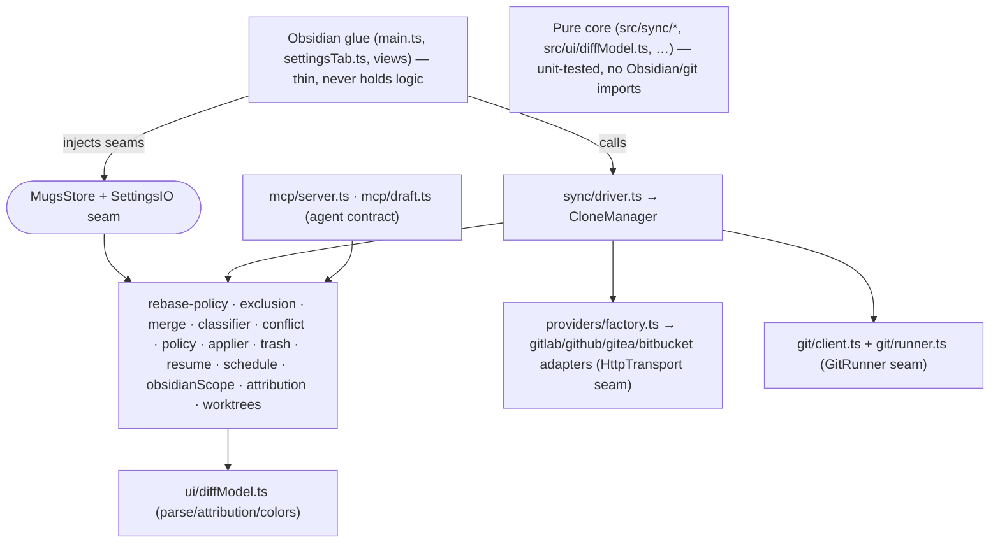

# MUGS — Multi-User Git Sync: Architecture & Decisions

This document is the single source of truth for how MUGS works, why it is built the way it is, where its design was inspired from, and how each hard problem was solved. It is written against the shipped code in `src/` and is meant to let a reader understand, review, and maintain the system independently of any one author.

> **Read guidance.** Start with §1 (the pipeline), skim §2 for the module map, then read §3 area-by-area in the order the areas were built (A→K). §4 maps each inspiration to where it lives. §5 is focused problem→solution writeups. §6 maps tests to behavior.

---

## 1. What MUGS is and how it works end-to-end

MUGS is an Obsidian plugin that syncs **selected folders of a vault** against **folders/subtrees of one or more remote git repositories**, for a team where different users may point the same mapping at different local folders. It is *multi-user* because (a) many people can share one repo while syncing only their own subtree, and (b) AI agents get first-class, attributed identities that edit in isolated branches alongside humans.

The guiding architectural invariant, repeated throughout, is:

> **All correctness-sensitive logic lives in pure, dependency-free, unit-tested modules under `src/sync/` (and a few under `src/ui/`, `src/providers/`, `src/membership/`). The Obsidian/glue layer (`main.ts`, `settingsTab.ts`, the views) is thin: it wires injected seams and renders data — it never contains merge, scope, or policy logic.**

This invariant is what makes 391 unit tests possible without a real git binary, network, or Obsidian runtime.

### 1.1 The sync pipeline

One **sync pass** (`syncAllMappings` in `src/sync/driver.ts`) runs over every folder mapping and, per mapping, delegates to one `CloneManager.syncMapping` pass against that mapping's local git clone. Per mapping the flow is:

```
credential → provider (REST adapter) → find repo → ensureClone
   → fetch
   → read topology: baseSha (last synced), localSha (HEAD), remoteSha (origin/branch)
   → decideSyncAction(topology)        [pure: rebase-policy.ts]
        │ none            → nothing to pull
        │ fast-forward    → git pull --ff-only
        │ rebase          → file-level 3-way merge of diverged paths (below), then ff/rebase
        ↓
   if push needed: stage in-scope working-tree changes → commit (+ agent attribution) → push
   → record last-sync state (resumable base SHA + op id)
```

**Pull-time content merge.** When the topology is a *rebase* (diverged histories with unpushed local work), `CloneManager.mergeContents` gathers every path that differs between the merge-base and each side, reads base/ours/theirs for each, and runs them through the pure merge pipeline (§3). Clean changes are written into the clone's working tree; only genuine overlaps surface as conflicts.

**Push-time scoping + attribution.** On push, `workingTreePaths()` lists changed files, they are filtered to those **in scope** (`isInScope`, §4), and only in-scope paths are staged. The commit is attributed normally — or, when an agent acts on the mapping (§10), to that agent with an `On-behalf-of` owner trailer.

### 1.2 The pure merge pipeline (one file)

Every diverged file flows through this deterministic sequence:

```
FileDiff { path, base?, local?, remote? }   (undefined = deletion, jj None)
   → classifyFile(diff)                      [classifier.ts]  up-to-date|local|remote|merged|conflict
   → threeWayMerge(base, ours, theirs)       [merge.ts]       MergeResult { content, conflict, ...Absent flags }
        │ delete cases resolved here (see §3.1)
        │ present-only → diff3 walk (LCS anchors + region classify)
        ↓
   policy.resolveConflictAuto(conflict, syncPolicy)  [policy.ts]  recency-wins → defaultResolution
        ↓
   applyMerge(entries)                         [conflict.ts]    → AppliedFile[] to write | FileConflict[] to surface
   orderApplyOps(applied)                      [applier.ts]     safe ordering (parents-first, deletes-last)
   ApplyGuard per-path                         [applier.ts]     no re-entrancy / feedback loop
   WorkingTreeWriter.writeFile(absPath, content)  (guarded by editorOpen guard — §5)
```

### 1.3 Component diagram (pure core vs Obsidian glue via DI)



The seams that make this testable: `SettingsIO` (store), `GitRunner` (git client), `HttpTransport` (providers), `WorkingTreeWriter` / `ConflictStore` / `EditorOpenGuard` / `LastSyncAccessor` (clone manager). `main.ts` supplies the concrete implementations; tests supply fakes.

### 1.4 Module map

| Area | Path(s) | Role |
|---|---|---|
| Data plane | `src/types.ts`, `src/schema.ts`, `src/store.ts` | Domain types, Zod source-of-truth, persistence + token handling |
| Git client | `src/git/{types,client,runner}.ts` | Thin git wrapper over an injectable runner |
| Providers | `src/providers/{factory,http,types,gitlab,github,gitea,bitbucket,schema}.ts` | REST adapters per backend behind one `Provider` interface |
| Membership | `src/membership/{types,merge}.ts` | Correlate remote roster + local activity into a summary |
| Scope/exclusion | `src/sync/exclusion.ts` | gitignore matcher, scope predicate, rename detection, conflict-path |
| Merge/conflict | `src/sync/{classifier,merge,conflict,policy,trash}.ts` | The 3-way pipeline + policy + recoverable deletions |
| Pull topology | `src/sync/rebase-policy.ts` | Pure pull-action decision from commit topology |
| Applier | `src/sync/applier.ts` | Safe write ordering + per-path re-entrancy guard |
| Resumable state | `src/sync/resume.ts` | Deterministic base-SHA + op-id resume key |
| Cadence | `src/sync/cadence.ts` | Human preset ↔ concrete interval mapping |
| Scheduling | `src/sync/schedule.ts` | Pause gate, visibility reducer, event debounce |
| Obsidian config | `src/sync/obsidianScope.ts` | Personal vs vault-wide `.obsidian/` classification |
| Commit message | `src/sync/commit-message.ts` | Deterministic greppable sync messages (+ on-behalf-of trailer) |
| Attribution/worktrees (A10) | `src/sync/{attribution,trees}.ts` | Agent attribution + isolated-branch lifecycle |
| MCP (A10) | `src/mcp/{server,draft}.ts` | Agent tool contract + commit-draft composition |
| Clone/driver | `src/sync/cloneManager.ts`, `src/sync/driver.ts` | Per-mapping orchestration + cross-mapping driver |
| Diff model (A7) | `src/ui/diffModel.ts` | Unified-diff parse, per-file attribution, author colors |
| Views (glue) | `src/ui/{mapView,diffView,diffPanel,diffRender,mapModel,dataSources,defaultDataSources,reviewQueueView}.ts` | Registered Obsidian views + data sources |

---

## 2. Design decisions & rationale (area by area)

### Area 1 — Folder granularity: full-folder vs subtree (+ fine-grained excludes)

**Problem.** A mapping either synced the whole repo (`remotePath = ""`) or a single subtree, with no way to drop individual files inside a scope.

**Options considered.** (a) A new allow/deny model; (b) reuse gitignore semantics already familiar to developers; (c) full path-prefix matching only.

**Chosen.** `includes`/`excludes` as **gitignore-style globs** on each mapping (`GitignoreMatcher` in `exclusion.ts`). `remotePath = ""` + excludes ⇒ *full-folder sync with exclusions*; a set `remotePath` ⇒ *subtree refined by globs*. The single effective predicate is `isInScope(config, path)` (subtree membership **and** include/exclude rules), wired into the driver for both pull (`mergeContents`) and push (`client.add` scoped paths).

**Tradeoffs.** gitignore semantics are well-understood and expressive (`!` negation, `*`/`**`/`?`, directory trailing slash). The cost is that globs can surprise users; the settings UI documents each field's meaning.

### Area 2 — Conflict resolution: automatic-first, git-reversible

**Problem.** Users want sync to feel continuous (like Obsidian Sync / Figma) with no manual prompts, yet never lose a side's content.

**Options considered.** Manual conflict UI (rejected: not "smooth"); last-write-wins only (rejected: loses content); **automatic-first + fully reversible via git history / `.mugs-trash`** (chosen).

**Chosen.** A top-level `sync` policy (`SyncPolicy`) with:
- `autoMerge` (default true): 3-way merge every divergence, apply clean results without prompting.
- `defaultResolution` ("both" | "theirs" | "ours", default "both"): tie-break for overlapping hunks. "both" best-effort combines and leaves markers only where it truly can't — never silently drops a side.
- `sameChangeAccept` (default true): jj's same-change rule — identical changes on both sides auto-resolve.
- `recencyWins` (default true): for a genuine conflict where both sides carry timestamps, keep the more-recently-saved side; otherwise fall back to `defaultResolution`.

The pure decision module (`policy.ts`) reads the injected policy and decides; it **never blocks sync**. The diff/panel view is a *monitoring* surface showing what merged and what was auto-resolved (and why). Reversibility (git history + trash) is what makes "no manual handling" safe.

### Area 3 — Deletes as first-class values (.mugs-trash) + real-time automatic merging + safe applier

**Problem.** The original merge treated a deleted file as `""`, so a local delete vs. remote modify showed as a false content conflict; and there was no recovery for deletions.

**Chosen (three coupled pieces):**

1. **Deletes as values (jj model).** Content is `string | undefined`; `undefined` is a deletion, strictly distinct from an empty file (`""`). `threeWayMerge` resolves every delete case deterministically (§3.1) before the line-level diff3 walk ever sees a deletion.
2. **Real-time automatic merging.** Clean divergences are auto-merged into the working tree on pull and pushed through the same pipeline — "real-time" is approximate (git polling), but local edits propagate via event triggers within one debounce window (§5).
3. **`.mugs-trash` (`trash.ts`).** Before any file is removed from a clone's working tree during sync, its content is recorded at `<clone>/.mugs-trash/<mapping>/<path>` so the deletion is recoverable and distinguishable from a user delete.

**Safe applier (`applier.ts`).** Two invariants keep write-backs from corrupting the tree: **ordering** (writes before deletes; writes parents-before-children, deletes children-before-parents — `orderApplyOps`) and **no re-entrancy** (`ApplyGuard` serializes per-path so a sync-triggered write can't re-enter and clobber an in-progress result).

#### 3.1 Delete-case matrix (what `threeWayMerge` guarantees)

| base | ours (local) | theirs (remote) | Result |
|---|---|---|---|
| absent | — | — | file never existed → gone |
| present | deleted | deleted | stays deleted |
| present | kept/modified | deleted | keep the surviving side (no conflict) |
| present | deleted | kept/modified | keep the surviving side (no conflict) |
| absent | added | added (identical) | collapse to one copy |
| absent | added | added (different, overlap) | conflict markers |
| absent | deleted | added | keep the addition |
| present | present | present | normal line-level diff3 merge |

The payoff: **no false content conflict on any delete case.** Only overlapping add/add or edit/edit conflicts surface.

### Area 4 — Right-sidebar diff panel (pinned)

**Problem.** Users want a live diff open beside their notes, not a full editor tab each time.

**Chosen.** A sidebar panel tab via `app.workspace.createPanelTab(...)` (`MugsConflictsPanel` in `diffPanel.ts`), living alongside Obsidian's built-in Outline/Tags/Backlinks. The shipped `obsidian.d.ts` lacked `createPanelTab`, so the module is augmented (same pattern as `Plugin.addStyleTag` in `main.ts`). The full-tab `DiffView` and the panel share one extracted renderer (`diffRender.ts`) — single source of truth for diff/conflict presentation, folding, and attribution.

### Area 5 — Sync frequency + adaptive cadence + event triggers + editor-open guard + resumable state

**Problem.** Aggressive polling wastes power and spams the backend; too lazy and sync feels broken. Local edits should propagate fast without polling every keystroke.

**Chosen:**
- `sync.intervalSeconds` drives a gated poll (`POLL_TICK_MS = 15s` internal tick; `decideRun` enforces the real interval). Presets: efficient (3600s), balanced (300s, default), near-realtime (30s) — `cadence.ts`.
- **Event triggers:** `vault.on('modify'|'create'|'delete')`, scoped to mapped folders, debounced (`EVENT_DEBOUNCE_MS = 20s`) into one sync per quiet window (`debounceFireTimes`). Immediate pass on foreground.
- **Editor-open write-back guard** (`editorOpen.ts`): never overwrite a file open in an editor with unsaved changes (mirror Obsync's `openEditors === 0` rule).
- **Resumable state** (`resume.ts`): last-sync is keyed on git base SHA + monotonic op id, not a timestamp, so an offline session resumes cleanly and reconnect reconciles deterministically.

**Correctness caveat.** True zero-latency is impossible with git polling; MUGS approximates real-time for local edits and pulls remote drift within one interval or on foreground. This caveat is stated honestly in the code and docs.

### Area 6 — Status-bar sync + conflict indicator (vault- and page-aware)

**Problem.** Users need at-a-glance sync state and a conflict marker that reflects the currently focused file.

**Chosen.** `addStatusBarItem()` re-rendered only when the rendered state changes (no flicker), using `setIcon` and theme color vars (`--color-*`, `--text-muted`). Page-aware: on active-leaf-change/file-open it resolves the owning mapping via `resolveMappingForPath` (§4) and shows that mapping's status glyph + label, plus a conflict count when the mapping (or the active file itself) has unresolved conflicts. Glyphs driven by `SyncOutcome.status`, including an explicit "paused" state.

### Area 7 — Diff view: per-change attribution + folding + action-labeled conflicts

**Problem.** "Who changed what" should be obvious without clutter; conflicts should read as *what each side did*, not opaque blobs; and large diffs should collapse.

**Chosen:**
- **Attribution.** `diffModel.ts` parses a unified diff and attributes each hunk to the file's most recent committing author (`attributeHunks`). Each author gets a stable, well-separated accent color (`assignAuthorColors`, golden-angle distribution); changed lines are tinted so "who did what" reads at a glance. (Per-*file* attribution is an intentional, testable approximation of per-hunk blame; full per-hunk blame lives behind the `AuthorsByFile` map the runtime supplies.)
- **Action-labeled conflicts.** Conflict regions render with action labels (`begin deleted left` / `begin added right`, Manyana-style) so a human sees what each side did.
- **Folding.** The shared renderer renders each hunk as a collapsible section and folds unchanged context by default (DOM-only, no git changes).

### Area 8 — Vault cleanup / maintenance mode: pause + human-in-the-loop review

**Problem.** Users need a safe way to make bulk edits without automatic sync interfering, then review everything before it goes out.

**Chosen:**
- **Global pause (`sync.paused`)** holds across reloads (durable) plus an in-memory lock. While paused: the poll is suspended, event triggers are suppressed, and the driver performs no auto-pull/push. Exposed via ribbon/command; shown with an explicit "paused" glyph (§6). Resuming runs exactly one reconciliation pass to catch up on drift made while paused. The pause gate is the pure `decideRun` (`schedule.ts`), which also vetoes while the window is hidden and enforces the minimum interval.
- **Review queue** (`ReviewQueueView`, `mugs-review`) models GitButler's staged-changes/draft-PR review: changes are curated into states *unstaged* (pending) / *staged* (selected for push) / *held* (deferred). Nothing leaves the machine without an explicit stage-and-push. State lives in the persisted `staging` map; the view is thin render + action.

### Area 9 — Obsidian config sync: personal vs vault-wide (`.obsidian/`)

**Problem.** Many users want to share vault-wide Obsidian config (snippets, templates, themes, plugin manifests) across a team while keeping user-specific state (editor settings, workspace, keymaps, per-plugin data) local. Previously `.obsidian/` was rejected entirely.

**Chosen.** Opt-in `sync.obsidianConfig.enabled`. When enabled, `.obsidian/` becomes its own built-in scope instead of being rejected; each top-level entry is classified **personal** (local-only, excluded from push/pull) or **vault-wide** (shared), reusing the gitignore matcher for fine control. Defaults: vault-wide = themes, snippets, templates, global.css, plugins/manifest.json (+ per-plugin data.json stays local); personal = settings.json, core.json, workspace.json, recent-files.json, keymaps.json. When disabled, `.obsidian/` is never synced (historical behavior preserved). Vault-wide JSON flows through the same 3-way merge/conflict pipeline as notes; personal divergence can't create noise in shared history.

### Area 10 — Sub-users / agents: isolated trees with first-class attribution (human-and-agent-first)

**Problem.** Give AI agents first-class, attributed identities that edit in isolated git worktrees ("trees") and flow through the exact same merge/review pipeline as humans — without forcing humans to use them and without giving agents priority.

**Chosen:**
- **Agent identity model.** `AuthorRef` already carries `kind: "human" | "agent"`, a stable `agentId`, an optional `ownerHuman`, and (via the `Agent` settings registry) a custom committer name/email + MCP endpoint. Agents are opt-in; the default experience is unchanged.
- **Isolated worktrees (`worktrees.ts`).** Each agent gets its own git branch (`mugs-agent/<slug>`) so parallel agents — and agents vs. humans — never clobber each other's unpushed work or shared history. The pure core derives a safe unique branch name (`slugForRef`, `agentBranch`, `uniqueAgentBranch`) and checks isolation (branch/path collision, `resolveWorktree`).
- **Agent-facing interface.** Two surfaces produce identical local commits: (a) an MCP server contract (`mcp/server.ts`) exposing agent tools (list/register/create-worktree); (b) a lightweight commit-draft format (`mcp/draft.ts`) that composes the on-behalf-of message + author. The transport in `main.ts` dispatches against these; both paths yield the same attributed commit.
- **Local-first, human-reviewed.** Agent edits become local commits on the agent's branch only — never auto-pushed. They appear in the review queue (§8) exactly like any other change; a human reviews and approves/merges them through the normal driver path.
- **Owner mapping / local vs remote.** Local commits carry the agent's own attribution; when merged and pushed, history records the owning human via an `On-behalf-of <owner>` trailer so remote blame maps back to a person (`attribution.ts`, wired into `commit-message.ts` + `cloneManager.ts`/`driver.ts` via the optional `pickAgent` seam).
- **Symmetry guarantees.** Agents act like humans (real attribution, same pipeline, no special merge privileges); humans keep full control (opt-in, review gate, nothing auto-pushed on agent authority). A vault with zero agents works exactly as before.

### Area 11 — Architecture & decisions documentation

This file. Produced during Phase K to capture the whole system so it can be understood, reviewed, and maintained independently of code.

---

## 3. Where inspiration was drawn (and where it lives)

| Inspiration | Transferable idea | Lives in MUGS at |
|---|---|---|
| **jujutsu (jj)** | `Merge<Option<File>>`: a deletion is `None`, distinct from empty; same-change rule (`merge.same-change = accept`) | `threeWayMerge` delete cases (`merge.ts`), `sameChange`/`classifyFile` (`classifier.ts`, `policy.ts`) |
| **GitButler** | Conflicted commits resolved later in any order; staged-changes / draft-PR review | durable per-mapping `conflicts[]` + `staging[]`; `ReviewQueueView` (`ui/reviewQueueView.ts`) |
| **Git worktrees + `On-behalf-of`** | Parallel isolated working dirs prevent clobbering shared history; trailers map agent commits back to a person | `worktrees.ts`, `attribution.ts`, `commit-message.ts` |
| **reconcile-text** | When you only see snapshots, use 3-way text merge (not a CRDT); word/sentence tokenization for markdown | snapshot diff3 in `merge.ts`; tokenization noted as future polish |
| **Collaborative-editing literature (CRDT vs OT vs Git 3-way)** | A vault-as-files system → Git 3-way; AST-aware merge on top | whole merge strategy (§2, Area 3) |
| **Manyana** | Conflict-free conflicts surfaced as *action-labeled* annotations (`begin deleted left`) | action-labeled conflict presentation in `diffRender.ts`/`diffPanel.ts` |
| **Real Obsidian sync plugins (Obsync)** | Never overwrite a file open with unsaved changes; apply writes folders-before-children/deletes-last with per-path serialization + feedback-loop guard | `editorOpen.ts`, `orderApplyOps`/`ApplyGuard` (`applier.ts`) |

---

## 4. How specific problems were solved

**Delete-as-first-class vs empty-string.** Content is `string | undefined`; `undefined` = deletion. `threeWayMerge` resolves all delete cases before the diff3 walk, so modify/delete and delete/delete never surface as false conflicts (`merge.ts`, §3.1).

**False-conflict avoidance on deletes.** The delete matrix (§3.1) guarantees a delete is resolved by content identity, not treated as an empty-file edit. `collectConflicts`/`applyMerge` only record a conflict when `threeWayMerge.conflict` is true.

**Real-time auto-merge without manual prompts.** `autoMerge` + event triggers (debounced) + clean-divergence write-back through the same pipeline (§5). Caveat: approximate, not zero-latency.

**Editor-open guard.** Writes skip any path currently open with unsaved changes (`editorOpen.ts`), so a remote/merge result never clobbers an in-progress edit.

**Path conflicts + `conflictPath`.** Two devices creating the same-named file (or a rename colliding) resolves to `Note (conflict <n>).md` via `uniqueConflictPath`, mirroring Obsync's convention (`exclusion.ts`).

**Rename detection via git content identity.** Moves are detected by matching removed/added content ids across snapshots (`detectRenames`) — git's own content-identity idea — instead of reinventing UID/hash matching like server-based sync. Empty content ids are ignored so empty files don't masquerade as renames.

**Per-line attribution + folding + action-labeled conflicts.** Per-file author attribution + stable accent colors, collapsible hunks, and Manyana-style conflict labels (`diffModel.ts`, `diffRender.ts`).

**Power-aware cadence.** Human presets ↔ concrete intervals (`cadence.ts`); poll gated by interval/hidden/paused (`schedule.ts`); event triggers for local edits.

**Resumable sync state.** Resume key = `<baseSha>\0<opId>`; offline sessions resume from the stored base SHA and reconcile forward, never re-deriving from a wall-clock timestamp (`resume.ts`).

**Page/vault-aware status.** `resolveMappingForPath` scopes an active file to its mapping; status bar renders that mapping's glyph + conflict count (§6).

**Isolated multi-agent edits.** Per-agent branch naming + isolation checks so parallel agents never clobber each other (`worktrees.ts`).

**Owner mapping local-vs-remote.** Local commits attribute to the agent; pushed history records the owner via an `On-behalf-of` trailer (`attribution.ts`, commit/driver wiring).

---

## 5. Validation & testing

All new logic lives in pure modules and is covered by **vitest with fakes** (no real git/network/Obsidian). The suite currently has **391 tests across 34 files** and stays green through every phase. High-value coverage, mapped to areas:

- **Merge correctness (Area 3):** same-change accept/keep; modify/delete both directions; delete/delete; delete/add; empty-vs-deleted distinction — `merge.test.ts`, `conflict.test.ts`.
- **Scope & integrity (Area 1):** full-repo vs subtree scoping with include/exclude globs; rename detection via git identity; path collisions → `conflictPath`; safe applier ordering + idempotent writes — `exclusion.test.ts`, `applier.test.ts`.
- **Editor-open checkpoint (Area 5):** real-time merge never clobbers a file open in an editor; resumable state survives offline→edit→reconnect — `editorOpen.test.ts`, `resume.test.ts` (+ driver tests).
- **Attribution & presentation (Area 7):** per-line author model + per-file author-set parser + graceful degradation; action-labeled conflict parsing — `diffModel.test.ts`.
- **Safety (Area 8):** pause gate suppresses poll/event/auto-push-pull while paused and runs exactly one reconcile on resume; staged-vs-unstaged classification; approval→driver handoff — `schedule.test.ts`, driver tests.
- **Config-sync (Area 9):** opt-in gating (disabled → rejected; enabled → allowed), default personal-vs-vault-wide classification, gitignore exclusion of personal entries, three-way merge/conflict handling of vault-wide JSON — `obsidianScope.test.ts`.
- **Agent sub-users (Area 10):** `AuthorRef` human/agent attribution + `On-behalf-of` trailer generation; worktree isolation under parallel agents; draft→message composition; MCP contract parity; owner mapping on push; zero-agents behavior unchanged — `attribution.test.ts`, `worktrees.test.ts`, `mcp/draft.test.ts`, `mcp/server.test.ts`, driver attribution tests.
- **Scheduling (Area 5/8):** interval honored, pause-on-hidden/resume-on-visible, debounced event trigger — `schedule.test.ts`.

**Gate before each phase:** TypeScript typecheck clean (`tsc --noEmit`), full suite passing (`npx vitest run`), and `npm run build` succeeding. **Final acceptance (Area 11 + render):** reinstall `main.js`/`manifest.json`/`styles.css` into a test vault, enable the plugin, and confirm every surface renders (settings sections, full-tab diff, right-sidebar panel, review queue, MCP registration, status bar); then review this document for accuracy against shipped code.

---

## 6. Build, run, and test

```bash
npm run build     # tsc --noEmit --skipLibCheck && node esbuild.config.min.js  (bundles CSS into main.js)
npx vitest run    # full pure-core suite (391 tests)
npm run dev       # esdev watch build for iteration
```

The plugin entry is `src/main.ts`; the settings tab is `src/settingsTab.ts`. Clones live under `<vault>/.mugs-clones/`. Everything correctness-sensitive is pure and unit-tested; the Obsidian layer is thin glue.
